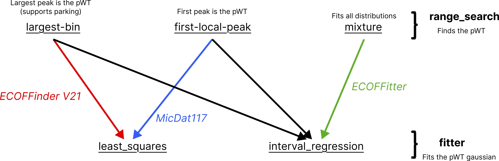

[](https://codecov.io/gh/fowler-lab/ECOFFitter)

# ECOFFitter

**ECOFFitter** fits interval-censored normal models to Minimum Inhibitory
Concentration (MIC) observations and estimates epidemiological cutoff values
(ECOFFs). It supports a single distribution, a finite mixture, and automatic
selection of the number of mixture components. Text and PDF reports can include
aggregate results and optional per-assay results.

It also implements a Python version of ECOFFinder V21 and MicDat117, both used to generate published ECOFF's by CLSI and ECUAST, respectively.

All three methods utilise different approaches for finding the pWT distribution and different algorithms for fitting the assumed gaussian. One can accordingly 'plug and play' different combinations of methods, such as using MicDat117's pWT finder by specifying `range_search = "first-local_peak"` and then harnessing the benefit of treating MICs as intervals by specifying `fitter = interval_regression`.





Demo input files are in `demo_files/`.

## Installation

Install from a local checkout:

```bash
pip install -e .
```

## Input data

Input can be a CSV, TSV, TXT, XLSX, or XLS file, or a DataFrame, array-like
sequence, or mapping when using the Python API. MIC values may be exact (for
example `0.25`), left-censored (such as `<=0.125`), or right-censored (such as
`>64`). Ratio values such as `1/2` are accepted; the numerator is used as the
MIC value.

A single-column input contains one MIC per row. Duplicate MIC values are
aggregated into counts. A canonical single-fit table has `MIC` and
`observations` columns:

```text
MIC     observations
0.06    1925
0.12    1165
0.25    341
0.5     69
1       27
2       27
4       13
8       29
<=0.03  1096
>8      2196
```

For aggregate and per-assay analyses, use a table with a `MIC` column and one
or more assay columns. Counts across assay columns are summed for the aggregate
fit. Each assay is fitted separately when individual fits are enabled.

Supported input extensions are `.csv`, `.tsv`, `.txt`, `.xlsx`, and `.xls`.
For Excel files, the first worksheet is used unless a sheet is selected through
the Python API.

## Configuration

The optional `--params` file can be YAML or TXT (`key=value`). Values in this
file override the corresponding manually supplied parameters. Supported keys
are `dilution_factor`, `distributions`, `boundary_support`, and `percentile`.

TXT example (`demo_files/params.txt`):

```text
dilution_factor=2
distributions=1
boundary_support=1
percentile=99
```

YAML example:

```yaml
dilution_factor: 2
distributions: 2
boundary_support: 1
percentile: 99
```

Set `boundary_support` to `None` in a parameter file to use unbounded tails for
censored observations.

## Python API

Fit one dataset directly:

```python
from ecoff_fitter import IntervalRegressionFitter

fitter = IntervalRegressionFitter(input="demo_files/censored.txt", distributions=1)
result = fitter.generate(percentile=99)
print(result)
```

Run the aggregate and optional per-assay workflow:

```python
from ecoff_fitter import run_ecoff_analysis

run = run_ecoff_analysis(
    "demo_files/multi_assay.txt",
    distributions=2,
    range_search="mixture",
    fit_individual=True,
    percentile=99,
)

print(run.global_report.to_text())
for assay, report in run.individual_reports.items():
    print(report.to_text(label=assay))
```

Choose the fitting method and WT selector independently. The two count-based
selectors can use either least squares or interval regression; mixture
selection is available with interval regression only:

```python
run = run_ecoff_analysis(
    "demo_files/multi_assay.txt",
    fitter="interval_regression",
    range_search="first-local-peak",
    fit_individual=True,
)

print(run.global_report.to_text(verbose=True))
```

`range_search` accepts `"largest-bin"`, `"first-local-peak"`, or `"mixture"`.
The first-local-peak selector uses the fixed 19-bin log2 MIC grid and requires
`dilution_factor=2`. The largest-bin selector uses the highest-frequency active
bin; `park_from_mic` can exclude higher bins before selection. Count-based
selectors fit one wild-type range. Mixture selection uses the interval-regression
mixture model and supports fixed or automatically selected component counts.

For example, select the largest active bin and fit it with interval regression:

```python
run = run_ecoff_analysis(
    data,
    fitter="interval_regression",
    range_search="largest-bin",
    park_from_mic=32,
)
```

Set `range_search="mixture"` and `distributions="auto"` in
`run_ecoff_analysis` to select a component count by the AIC or BIC criterion. `max_distributions` sets the largest count
to consider; `criterion`, `min_delta`, `min_pi`, and `min_separation` control
the selection checks. The selected aggregate count is available as
`run.selected_k`.

## Command-line usage

The CLI accepts a dataset with a `MIC` column and either `observations` or one
or more assay columns:

```bash
ecoff-fitter \
  --input demo_files/multi_assay.txt \
  --fitter interval_regression \
  --range_search largest-bin \
  --park_from_mic 32 \
  --percentile 99 \
  --fit_individual \
  --outfile demo_files/output.pdf
```

Run `ecoff-fitter --help` for the complete option list. The same CLI is
available as `python -m ecoff_fitter`.

| Option                                 | Default                 | Description                                                                  |
| -------------------------------------- | ----------------------- | ---------------------------------------------------------------------------- |
| `--input INPUT`                      | Required                | Input MIC dataset.                                                           |
| `--fitter METHOD`                    | `interval_regression` | `least_squares` or `interval_regression`.                                |
| `--range_search METHOD`              | None                    | `largest-bin`, `first-local-peak`, or `mixture`.                       |
| `--params PARAMS`                    | None                    | YAML or TXT parameter file; file values override matching options.           |
| `--dilution_factor N`                | `2`                   | Ratio between adjacent MIC dilution steps.                                   |
| `--distributions K`                  | `1`                   | Number of normal components to fit.                                          |
| `--boundary_support N`               | `1`                   | Number of dilution steps used to extend censoring bounds.                    |
| `--percentile P`                     | `99.0`                | Percentile used to calculate the ECOFF.                                      |
| `--fit_individual`                   | Off                     | Fit each assay column as well as aggregate observations.                     |
| `--density`                          | Off                     | Plot probability density instead of counts.                                  |
| `--detection_level P`                | `10.0`                | Minimum eligible local-peak size as a percentage of observations.            |
| `--park_from_mic MIC`                | None                    | Exclude this MIC and higher bins before largest-bin selection.               |
| `--cumulative` / `--no-cumulative` | On                      | Use cumulative counts or per-bin frequencies in least-squares range fitting. |
| `--first_best`                       | Off                     | Stop range search after its score starts increasing.                         |
| `--outfile PATH`                     | None                    | Write a text report (`.txt`) or PDF report (`.pdf`).                     |
| `--verbose`                          | Off                     | Include model details in printed text output.                                |

## Output

The results are printed to the terminal. With `--outfile`, the CLI also writes a
text or PDF report. PDF reports show observed MIC intervals, fitted component
curves, and the ECOFF marker. When per-assay fits are enabled, the report
contains the aggregate fit and individual assay fits.

## License

MIT License.
